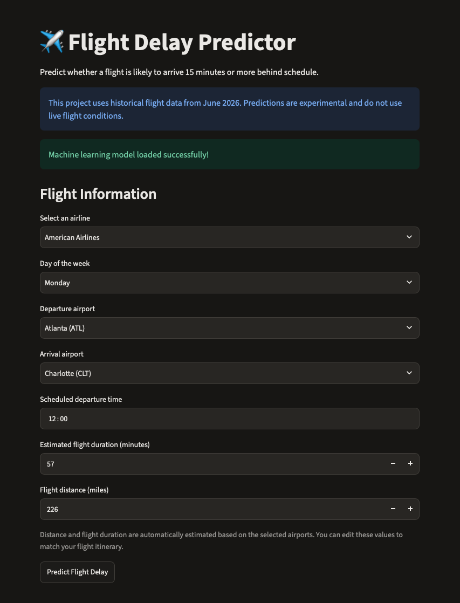
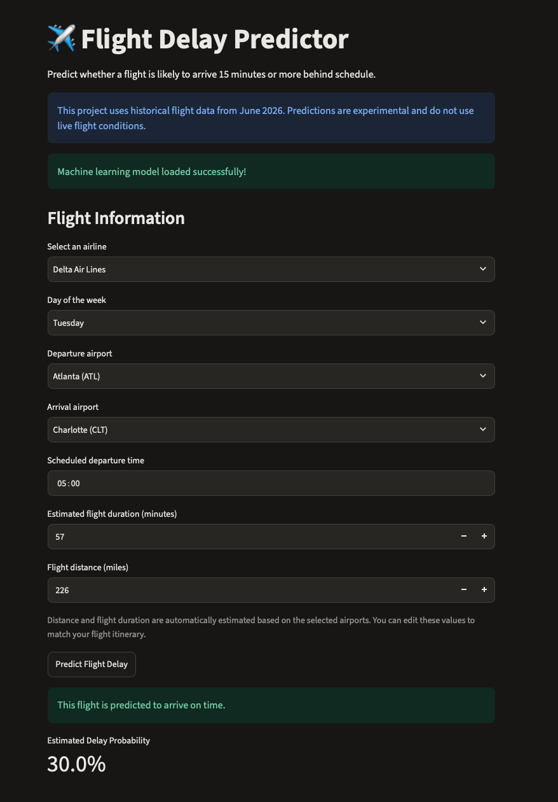
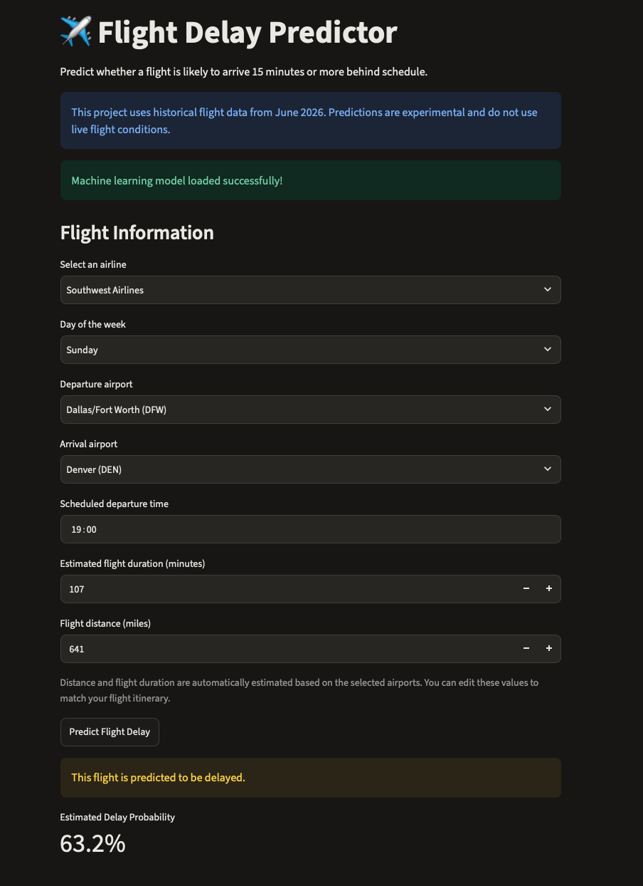

# Flight Delay Prediction ✈️

An interactive machine learning application that predicts whether a U.S. domestic flight is likely to arrive 15 minutes or more behind schedule.

**[Try the Live Application](https://flight-delay-predictor-jb.streamlit.app)**

## Project Overview

Flight delays affect millions of travelers each year. I wanted to explore how factors such as airline, departure time, airport, and flight distance relate to delays and whether those patterns could be used to make predictions.

Using historical U.S. flight data, I explored delay trends, prepared the data for machine learning, trained and evaluated classification models, and built an interactive web application using Streamlit.

## Dataset

**Source:** U.S. Department of Transportation, Bureau of Transportation Statistics (BTS)

**Period:** June 2026

**Records:** 671,781 original flight records; 657,765 retained after cleaning.

The prediction target is `ARR_DEL15`, which indicates whether a flight arrived at least 15 minutes late.

Cancelled and diverted flights were excluded because they did not have a valid arrival-delay classification.

## Exploratory Data Analysis

Some patterns I found in the June 2026 data:

- **Airlines:** Southwest had the highest observed delay rate at approximately 34%, while Delta had the lowest at approximately 18%.
- **Day of the week:** Sunday had the highest delay rate at approximately 31%, while Tuesday had the lowest at approximately 19%.
- **Departure time:** Delay rates generally increased throughout the day, reaching approximately 38% during the evening.
- **Airports:** Among the 10 busiest origin airports, Dallas/Fort Worth had the highest observed delay rate at approximately 36%.
- **Distance:** Flights between 1,000 and 1,499 miles had the highest delay rate among the distance groups analyzed.

These findings describe the June 2026 dataset and should not be interpreted as universal patterns.

## Machine Learning

I used features available before departure, including:

- Airline and day of the week
- Departure and destination airports
- Scheduled departure hour
- Scheduled flight duration
- Flight distance

The data was divided into training and testing sets, with 80% used for training and 20% held out for evaluation.

Categorical features were encoded, and numerical features were processed using a scikit-learn pipeline.

I experimented with multiple classification models and selected a Random Forest model for the interactive application.

## Model Performance

Three classification models were evaluated using a held-out test set.

| Model | Accuracy | Precision | Recall | F1 Score |
|---|---:|---:|---:|---:|
| Logistic Regression | 75.32% | 55.57% | 12.72% | 20.70% |
| Balanced Logistic Regression | 64.93% | 38.56% | 64.90% | 48.38% |
| Random Forest | 64.43% | 38.35% | 66.55% | 48.66% |

Although standard Logistic Regression achieved the highest accuracy, it identified only 12.72% of delayed flights.

Random Forest achieved the highest recall (66.55%) and F1 score (48.66%) of the three models, making it the preferred model for this project.

Because delayed flights represent approximately 25% of the dataset, accuracy alone is not sufficient to evaluate model performance.

The selected model still has limitations, particularly its relatively low precision. Its predictions should be treated as experimental rather than reliable operational forecasts.

## Interactive Application

The Streamlit application allows users to select flight details and receive a predicted delay classification along with an estimated delay probability.

Features include:

- Airline and airport selection
- Custom departure times
- Automatic distance calculations
- Estimated flight durations
- Editable flight information
- Input validation

The application uses a saved machine learning model, so predictions can be generated without retraining the model each time.

## Application Screenshots

### Flight Prediction Interface

### Predicted On-Time Arrival

The model predicts an on-time arrival with an estimated
delay probability of 30.0%.

### Predicted Delayed Arrival

The model predicts a delayed arrival with an estimated
delay probability of 63.2%.

## Tools and Technologies

**Python · Pandas · NumPy · Matplotlib · Scikit-learn · Streamlit · Git · GitHub · Joblib**

## Limitations and Future Improvements

This is an experimental project based on one month of historical flight data. Predictions do not incorporate live weather, air traffic, or current airline operations.

Automatically calculated flight durations are estimates rather than published airline schedules. The model currently uses departure hour rather than individual minutes.

Future improvements could include additional months of data, weather information, more airports, probability calibration, and further model evaluation.